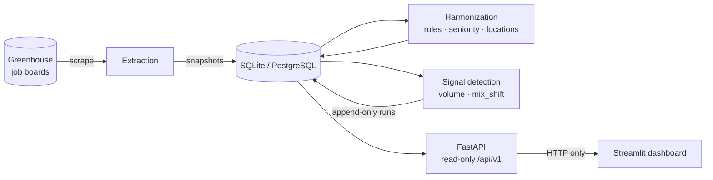

# JobSignal

[](https://github.com/LionyRamli/JobSignal/actions/workflows/test.yml)


**Predictive business intelligence from job-market data.**

Companies reveal expansion plans through hiring before they announce them. JobSignal collects
public ATS (Applicant Tracking System) job postings, normalizes them into a common taxonomy and
flags statistically unusual hiring changes. The result is evidence-based early warning of
expansion, investment priorities and emerging B2B opportunities.

---

## Contents

- [Features](#features)
- [Architecture](#architecture)
- [Getting started](#getting-started)
- [How to run](#how-to-run)
- [Configuration](#configuration)
- [Security](#security)
- [Quality assurance](#quality-assurance)
- [API reference](#api-reference)
- [Dashboard](#dashboard)
- [Methodology](#methodology)
- [Data model](#data-model)
- [Project layout](#project-layout)
- [Roadmap](#roadmap)

## Features

| Area | What it does |
|------|--------------|
| **Extraction** | Hardened scraper for public Greenhouse job boards, behind a common `ATSSource` interface so other ATS sources plug in without changing the core. A snapshot is stored for every run |
| **Harmonization** | Deterministic spaCy rules map titles to 16 role families and 7 seniority levels, and raw locations to ISO 3166 places. Accuracy is gated in CI on hand-labelled data |
| **Signal detection** | Rolling-baseline z-scores flag hiring **expansions and contractions** per company, role family and country. Coverage-aware: weeks with scrape outages are never scored |
| **API** | Read-only FastAPI service with keyset pagination, drill-down from a signal to its postings, server-side aggregates and 8-week trends |
| **Dashboard** | Streamlit alerting dashboard: yellow and red bands from the z-score, sparklines and deltas, company trends, a stale-data warning, and postings loaded on demand |

## Architecture



- **One-way dependencies:** extraction → harmonization → signals.
- **The API is the only data path to the dashboard.** The dashboard never imports the storage
  layer, and a test enforces this.
- **Schema migrations** are managed by Alembic.

## Getting started

### Prerequisites

- Python **3.12**
- [uv](https://docs.astral.sh/uv/) (dependency and environment manager)
- Git, plus optionally [gitleaks](https://github.com/gitleaks/gitleaks) for the pre-commit
  secret scan

### Install

```bash
git clone https://github.com/LionyRamli/JobSignal.git
cd JobSignal
uv sync                       # install the exact locked dependencies
uv run pre-commit install     # scan staged changes for secrets before every commit
cp .env.example .env          # optional: override settings (see Configuration)
uv run alembic upgrade head   # create or migrate the local SQLite database
```

## How to run

### 1. Build the data (pipeline)

Run these in order: scrape, then harmonize, then detect. Schedule them daily: the volume
detector needs at least 8 weeks of continuous scraping.

```bash
uv run python scripts/run_scrape.py anthropic databricks stripe   # fetch and store postings
uv run python scripts/run_harmonize.py                            # role, seniority, location taxonomy
uv run python scripts/run_detect.py                               # score hiring signals
```

Every command exits `0` on success and `2` if the database schema is missing (run
`uv run alembic upgrade head`). `run_scrape.py` exits `1` if any company failed or was
incomplete.

### 2. Start the API

```bash
uv run python scripts/run_api.py              # http://127.0.0.1:8000  (docs: /docs)
```

Options: `--host` (default `127.0.0.1`) and `--port` (default `8000`). Binding to anything other
than localhost requires `JOBSIGNAL_API_KEY`. Always use this script rather than `uvicorn`
directly, because the script enforces that check.

### 3. Start the dashboard

With the API running, in a second terminal:

```bash
uv run python scripts/run_dashboard.py        # http://127.0.0.1:8501
```

Options: `--host` (default `127.0.0.1`), `--port` (default `8501`) and `--allow-remote` (needed
for any non-localhost host; the dashboard has **no login**). The dashboard finds the API through
`JOBSIGNAL_API_URL`.

## Configuration

Settings load from `JOBSIGNAL_*` environment variables or a local `.env` file (never commit it).

| Variable | Default | Purpose |
|----------|---------|---------|
| `JOBSIGNAL_DATABASE_URL` | `sqlite:///jobsignal.db` | SQLAlchemy URL (PostgreSQL in production) |
| `JOBSIGNAL_LOG_LEVEL` | `INFO` | `DEBUG` / `INFO` / `WARNING` / `ERROR` / `CRITICAL` |
| `JOBSIGNAL_API_KEY` | *(empty)* | Required to bind the API beyond localhost; clients send it as `X-API-Key` |
| `JOBSIGNAL_API_CORS_ORIGINS` | *(empty)* | Comma-separated browser origins allowed by CORS (GET only); empty means CORS is off |
| `JOBSIGNAL_API_URL` | `http://127.0.0.1:8000` | Where the dashboard finds the API (http/https only) |

## Security

| Layer | Control |
|-------|---------|
| **Scraping** | https only, no redirects, strict timeouts, a response-size cap, retries with backoff that honour `Retry-After`, and a descriptive User-Agent. Board tokens are validated against a strict pattern before use |
| **API** | Read-only `GET` routes. Binds to localhost by default and refuses another host without an API key. The key is compared in constant time. Errors are generic, with no tracebacks. Ids are bounded to 64-bit integers. JSON never contains NaN or Infinity. CORS is opt-in |
| **Dashboard** | Binds to localhost by default (`.streamlit/config.toml` and the launcher); another host needs `--allow-remote` and prints a warning. The API key stays on the server and is never shown. Scraped text is rendered only as data, never as HTML or markdown. Only `http(s)` links are clickable. Error details and usage statistics are off |
| **Repository** | A gitleaks pre-commit hook scans every commit. CI actions are pinned by commit SHA with read-only permissions. Dependabot updates both GitHub Actions and the uv lockfile |

Report security issues privately to the maintainer rather than in a public issue.

## Quality assurance

```bash
uv run pytest                                      # full test suite (unit + integration)
uv run pytest --cov=jobsignal                      # with coverage
uv run ruff check . && uv run ruff format --check .
```

- CI (GitHub Actions) runs `uv sync --locked`, ruff and the test suite with coverage on every
  push and pull request.
- **No live network in tests.** Scraper tests replay recorded ATS fixtures. API and dashboard
  tests run against a real, migrated temporary database.
- **Mutation-checked guards.** The security controls (API key, bind guards, URL sanitizing,
  the dashboard boundary) have tests proven to fail when the guard is removed.
- **Accuracy gates.** Harmonization must score ≥ 90 % on titles and ≥ 95 % on locations, on
  hand-labelled real data.

## API reference

A read-only service: every route is a `GET` under `/api/v1`. Interactive OpenAPI docs are at
`http://127.0.0.1:8000/docs`.

| Route | Returns |
|-------|---------|
| `/health` | `ok`, or 503 `schema_missing`, plus the taxonomy and signals versions |
| `/meta` | Role families, seniorities, location kinds, signal levels and detectors (for filters) |
| `/companies`, `/companies/{board_token}` | Open-posting counts and the latest scrape |
| `/companies/{board_token}/composition` | Open postings counted by role family, seniority and country (computed on the server) |
| `/company-trends?weeks=12` | Weekly `open_postings` and `new_postings` per company (`null` means no trustworthy scrape that week) |
| `/postings` | Filters: `company`, `role_family`, `seniority`, `country`, `open`. Up to 200 items per page with a `next_cursor` |
| `/postings/{id}` | One posting with its canonical locations and open/close history |
| `/signal-runs` | Runs, newest `as_of` first, with their parameters and versions |
| `/signals` | `run=latest` or an id; filters `detector`, `direction`, `level`, `company`, `min_abs_z`, `signals_only`. Includes the raw z and inputs; `mix_shift` rows add `share_recent`/`share_baseline` and are marked `provisional` |
| `/signals/{id}` | One score, its run and the postings behind it (drill-down) |
| `/signals/trends?ids=…` | 1–50 scores: each cell's last 8 weeks (`value`, `z`), recomputed from the data the run saw. The last point equals the stored score. Uncovered weeks are `null` |

## Dashboard

| Tab | Shows |
|-----|-------|
| **Alerts** | KPI tiles with the change since the previous week's run and a z-score chart. Alert groups: one event seen at several levels is one row, with "also at". Each row has an 8-week sparkline, Δz vs the previous week and Δ vs baseline. The alert detail has a plain-English explanation, a trend chart and the postings behind the alert |
| **Companies** | Per company: 12-week open-postings and new-postings sparklines and Δ vs the previous week. For the selected company: composition charts and a postings table, filtered on the server and loaded 200 rows at a time (**Load 200 more**) |
| **Runs & health** | API status, versions, run history and run parameters |

- **Bands:** red when |z| > 5, yellow when 3 ≤ |z| ≤ 5. The band is always also written as text.
- **Freshness:** API reads are cached for 60 s (**Refresh now** clears the cache). A warning names
  any company whose last scrape is older than 36 h or did not finish `ok`.
- **Cold start:** volume trends need 8 covered weeks of scraping. Until then they show gaps
  ("Not enough history yet"). `mix_shift` is provisional and labelled as such.

## Methodology

### Harmonization

`run_harmonize.py` classifies every stored posting whose taxonomy version is missing or
outdated. Results are deterministic: spaCy phrase rules and a gazetteer are kept in
`src/jobsignal/harmonization/data/`.

| Dimension | Values |
|-----------|--------|
| Role family (16) | software_engineering, ml_research, data, solutions_engineering, security, product_management, program_management, design, sales, customer_success, marketing, operations, finance, legal, people, other |
| Seniority (7) | intern, entry, mid, senior, staff_plus, manager, director_plus (mid when there is no signal) |
| Location | `kind\|country\|region\|city` with ISO 3166 codes. Kinds: city, region, country, remote. A posting can have several |

- Unresolvable places are reported, never guessed.
- Editing a rule file requires bumping `TAXONOMY_VERSION`, and CI enforces this. A bumped
  version reprocesses every posting.
- A 25 % holdout split of the labelled data is reported separately.

### Signal detection

`run_detect.py` scores hiring at four levels: company, company + role family, company +
country, and company + role family + country. Each run is stored append-only, with its
parameters, the taxonomy version, and the raw z, observed and baseline values of every row.

| Detector | Basis | Question | Signal |
|----------|-------|----------|--------|
| `volume` | New openings **observed** each week | Is this week unusual for this cell? | z ≥ 3 with ≥ 5 openings (expansion); z ≤ −3 with a baseline ≥ 5 (contraction) |
| `mix_shift` *(provisional)* | ATS `first_published` dates | Did this cell's share of the company's openings jump (last 4 vs previous 12 weeks)? | Expansions only by default (z ≥ 3, ≥ 5 openings) |

- **Scoring.** A week is compared with the previous 8 *measurable* weeks:
  `z = (x − μ) / sqrt(max(s², μ, 1))`. The Poisson floor stops sparse cells from producing
  extreme scores. As a result, a cell whose baseline is below 9 a week cannot signal a
  contraction.
- **Coverage.** A week is measurable only when scraping covered it continuously. Every gap
  between successful scrapes that touches the week must be at most max(48 h, 1.5 × the
  company's usual gap).
  - An outage therefore hides its own week **and** the backlog week after it.
  - Weeks with a bulk board re-import or a collapsed board are hidden too.
  - The first scrape's week never counts.

### Known limitations

- **Cold start.** `volume` needs ≥ 8 measurable weeks after the first scrape. Until then it
  reports `insufficient_history`.
- **`mix_shift` is survivorship-biased.** It only sees postings that are still open. In
  simulation, fast-filling roles showed an "expansion" in about half of runs with no real change.
  Treat it as a lead to investigate, not as evidence. Its contractions are not flagged by
  default.
- **False positives.** With 8 baseline weeks and bursty posting, simulated false-positive rates
  are about 0.2–1 % (Poisson) to 3–4 % (overdispersed) per cell-week, against a nominal 0.13 %.
  That means roughly 1–15 false `notable` expansions per run. Recalibrate the threshold once real
  history exists.

## Data model

| Table | Holds |
|-------|-------|
| `companies` | One row per (ATS source, board token) |
| `scrape_runs` | Each scrape run: `running` → `succeeded` / `partial` / `failed` |
| `snapshots` | One fetch of one company in one run: `ok` / `partial` / `failed` |
| `postings` | Latest state of each posting, plus `first_seen_at` / `last_seen_at` / `closed_at` |
| `snapshot_postings` | Which postings were open in each snapshot (the time series) |
| `locations`, `posting_locations` | Canonical places and the posting–place links |
| `signal_runs`, `signal_scores` | Append-only detection runs and every scored cell |

A posting is closed only when a **complete** fetch no longer lists it; failed or partial fetches
never close anything. Run one scrape at a time per database.

## Project layout

```
src/jobsignal/
  extraction/      ATS sources and the hardened HTTP client
  harmonization/   role, seniority and location taxonomy (rules in data/)
  signals/         weekly features, coverage, detectors, drill-down, trends
  storage/         SQLAlchemy schema and the repository (the only DB access layer)
  api/             FastAPI app, routes, response schemas, launcher
  dashboard/       Streamlit app logic: API client, alerts, trends, charts, launcher
  config.py, logger.py, models.py, scrape.py, harmonize.py, detect.py
dashboard/app.py   Streamlit entry point
alembic/           database migrations
scripts/           command-line entry points (run_*.py)
tests/             unit/ and integration/ tests; fixtures/ holds recorded ATS responses
docs/superpowers/  design specs and implementation plans for each phase
```

## Roadmap

- **Phase 1 (MVP), complete:** extraction, storage, harmonization, signal detection, API and
  dashboard.
- **Phase 2:**
  - posting duration (time-to-fill) as a talent-crisis indicator per sector;
  - joining hiring signals with public stock-price trends;
  - more ATS sources (Ashby, Lever, Workday);
  - migration to PostgreSQL.

Open follow-ups are tracked in [`TASKS.md`](TASKS.md).

---

*JobSignal is a university computer-science project. No open-source license has been chosen
yet.*
